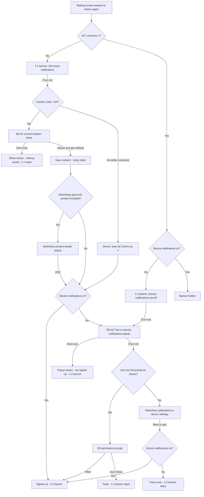

# Result notification sign-up flow

Sources: PRD Front-end requirements ch. 7 (REQ-701 – 705), Back-end requirements ch. 7 (BE-701 · 702), Figma 02-1 Get notified bottom sheet · popups, 02-2 Get notified flow. The Korean PRD is the source of truth; on any difference, the PRD wins. UI copy below is the English copy used in the prototype.

## 1. Overview

- Location: the notification banner on the waiting screen (DV-P02). No other screen has this banner.
- Channel: app push, sent when the round's result is judged.
- Signed-up condition: all 3 consent items are Y and device notifications are on. The server keeps no separate "signed up" value.
- The server does not track device notification permission. The app asks the OS.
- Country is decided by the country code generated automatically when the app is opened (KR / other).

## 2. Consent items and where they are saved

| Consent item (as shown in the sheet) | Saved to (existing notification settings) |
| --- | --- |
| [Required] Consent to receive service notifications | Required notifications |
| [Required] Consent to receive marketing information | Marketing information consent |
| [Required] Consent to receive advertising app push | Marketing notifications |

- Values saved here are reflected as-is in the existing notification settings screen.
- Each item's value and consent time are saved per item.

## 3. Banner states (REQ-701)

| State | Condition | Banner copy | Button |
| --- | --- | --- | --- |
| 1-1 | Any of required notifications · marketing information consent · marketing notifications is N | "Get result notifications" / "We'll notify you when the call result is out" | [Turn on] |
| 1-2 | All 3 Y + device notifications off | "Device notifications are off" / "We'll notify you when the call result is out" | [Turn on] |
| 1-3 | Right after sign-up completes | "You're signed up" / "We'll notify you when the result is out" | "Signed up" (disabled) |
| Hidden | All 3 Y + device notifications on (except right after 1-3) | — | — |

- On entering the waiting screen, the banner state is decided from the 3 consent values and the device notification state.
- The 1-2 banner shows every round while its condition holds.
- The 1-3 banner shows only while the user stays on the same screen right after signing up. From the next entry the banner is hidden.
- When consent or permission changes, the banner updates on the same screen (e.g. after consenting from 1-1 with device notifications off → 1-2).

## 4. [Turn on] handling order (REQ-702)

| Start | Country · state | Handling |
| --- | --- | --- |
| 1-1 [Turn on] | Country code KR | Show the consent bottom sheet (BS-01) |
| 1-1 [Turn on] | Outside KR | No consent screen; the server saves all 3 items as Y → device notifications on: 1-3, off: BS-02 |
| 1-2 [Turn on] | — | Show BS-02 |
| BS-01 [Agree and get notified] | Consent includes advertising app push | Save consent · close sheet → Marketing consent details popup → [OK] → check device notifications |
| BS-01 [Agree and get notified] | Consent does not include advertising app push | Save consent · close sheet → check device notifications |
| Check device notifications | On | Signed up → 1-3 |
| Check device notifications | Off | Show BS-02 |

How consent is handled outside KR is subject to legal review of the Terms of Use and Privacy Policy.

## 5. Step-by-step flow

1. The user enters the waiting screen. The app decides the banner state (1-1 / 1-2 / hidden) from the 3 consent values and the device notification state.
2. The user taps [Turn on] on the 1-1 banner.
   - Country code KR: go to step 3.
   - Outside KR: the server saves all 3 items as Y; go to step 6 (check device notifications).
3. The consent bottom sheet (BS-01) opens. Only items not yet agreed are shown, all unchecked by default.
   - [Not now]: the sheet closes and nothing is saved. The 1-1 banner stays.
   - [Agree and get notified]: enabled only when every shown item is checked. Tapping saves consent and closes the sheet.
4. If advertising app push consent was given this time, show the Marketing consent details popup. Otherwise go to step 6.
5. [OK] on the Marketing consent details popup goes to step 6.
6. The app checks the device notification state.
   - On: signed up. The banner changes to 1-3.
   - Off: show the Turn on device notifications popup (BS-02).
7. [Turn on] on the 1-2 banner shows BS-02 directly.
8. On BS-02:
   - [Not now]: the popup closes and the user is not signed up. The 1-2 banner shows.
   - [Turn on]: the popup closes and the app asks the OS whether the OS permission prompt can be shown.
9. If the OS prompt can be shown, show it. Its copy and form are provided by the OS as-is.
   - Allow: signed up, banner 1-3.
   - Don't Allow: show the toast "Device notifications are off, so you can't get result notifications" and keep the 1-2 banner.
10. If the OS prompt cannot be shown, open the TetherMax notification screen in the device Settings app. The user turns notifications on there.
11. When the user comes back and the waiting screen shows again, the app re-checks device notifications (section 7).

## 6. Screens

### 6.1 Consent bottom sheet (BS-01, Figma DV-S08)

| Area | Content · copy | Condition · note |
| --- | --- | --- |
| Title | "To get call result notifications, consent is required" (2 lines) | — |
| Subtext | "Just checking the result earns you rewards" | — |
| Notification preview card | "TetherMax · now", "(Ad) Your call result is out", "Get your rewards and keep your streak going" | Same copy as the actual push |
| Agree to all | Checkbox + "Agree to all" | Only when 2 or more items are shown |
| Consent items | Checkbox + item name + > on the right | Only items not yet agreed. All unchecked by default |
| Helper text | "Result notifications include rewards and event info, so consent is required" | Under the advertising app push item |
| Buttons | [Agree and get notified], [Not now] | Stacked |

- Agree to all checks or unchecks every item. Checking every item also checks Agree to all.
- Tapping > opens the consent details popup. Its copy is finalized after legal review.

### 6.2 Marketing consent details popup (next to Figma DV-S08)

Reuses the Marketing consent details popup of the existing notification settings screen.

| Area | Content · copy |
| --- | --- |
| Title | "Marketing consent details" |
| Body | "• Sender: TetherMax" / "• Received at: {YYYY.MM.DD HH:MM:SS} UTC" / "• Action: consent to marketing information notifications" / "• Marketing information terms" |
| Button | [OK] |

- Received at is the time consent was saved (UTC), returned by the server when saving.
- [OK] closes the popup and goes to the device notification check.

### 6.3 Turn on device notifications popup (BS-02, Figma DV-S06)

| Area | Content · copy |
| --- | --- |
| Title | "Device notifications are off" |
| Subtext | "Turn on notifications to hear about results right away" |
| Notification preview card | Same as BS-01 |
| Buttons | [Turn on], [Not now] |

[Turn on] handling

| OS prompt | Result | Handling |
| --- | --- | --- |
| Can be shown | Allow | Signed up → 1-3 |
| Can be shown | Don't Allow | Toast "Device notifications are off, so you can't get result notifications" → 1-2 |
| Cannot be shown | — | Open the TetherMax notification screen in device Settings |

- The app asks the OS whether the prompt can be shown. E.g. on Android a user who declined once can be prompted again; on iOS a user who declined cannot.
- The toast shows at the bottom of the screen for 2 seconds.

## 7. Returning to the waiting screen (REQ-705)

Whenever the waiting screen shows again (back from background or a fresh app launch), the app re-checks device notifications and updates the banner.

| Device notifications | Banner | Toast |
| --- | --- | --- |
| On | 1-3 (You're signed up) | None |
| Off | 1-2 (Device notifications are off) | Only on the first return after going to device Settings via [Turn on]: "Device notifications are off, so you can't get result notifications" (once per [Turn on] tap) |

- Consent is already saved, so there is no separate sign-up step.
- The fact that the user went to Settings is not saved on the server.
- How the webview detects the return to the app needs dev confirmation.

## 8. Flowchart (Mermaid)

## 9. Server (BE-701 · 702)

| ID | Handling |
| --- | --- |
| BE-701-1 | Return the member's 3 consent values and country code |
| BE-701-2 | KR members: save the value and consent time of each item agreed in the bottom sheet |
| BE-701-3 | Members outside KR: on [Turn on], save all 3 items as Y without a consent screen (subject to legal review) |
| BE-701-4 | When advertising app push consent is saved, return the consent time (UTC) |
| BE-701-5 | Values saved here are reflected as-is in the existing notification settings |
| BE-702-1 | When a round is judged, send an app push to members who voted in that round and have all 3 consents Y |
| BE-702-2 | Copy: "(Ad) Your call result is out" / "Get your rewards and keep your streak going". Sent in the member's language |
| BE-702-3 | Tapping the push opens the mission (deep link). After entry the unviewed result shows first |
| BE-702-4 | Once per member per round. If judging is late, send after judging |
| BE-702-5 | Re-check consent right before sending. Do not send to members who withdrew consent in the meantime |
| BE-702-6 (P1) | Sending may be split to handle bulk sends and traffic right after judging (method to be confirmed by dev) |

## 10. Exception

| Code | Situation | Handling |
| --- | --- | --- |
| E08 | Device notifications not allowed | Toast "Device notifications are off, so you can't get result notifications", 1-2 banner stays |

## 11. Prototype cases

| Case | Content |
| --- | --- |
| DV-N01 | Operate the whole flow (change country · device notifications · OS prompt availability in the device state panel) |
| DV-P02-b | Waiting screen · 1-1 banner |
| DV-P02-c | Waiting screen · 1-2 banner |
| DV-P02-d | Waiting screen · right after sign-up (1-3) |
| DV-P02-s3 | Waiting screen · banner hidden |
| DV-S08 | Consent bottom sheet (BS-01) |
| DV-S08-m | Marketing consent details popup |
| DV-S06 | Turn on device notifications popup (BS-02) |
| DV-S05 | OS permission prompt (simulation) |
| DV-S07 | Going to device Settings (simulation) |

## 12. To confirm (legal)

- Notice of consent result: whether the existing "Marketing consent details" popup is enough
- Whether a result notice is required when only marketing information consent is newly given
- Making advertising consent a condition for result notifications (including the [Required] label in the sheet)
- How to mark advertising pushes with (Ad)
- Consent details popup copy: written after the revised Terms · Privacy Policy are final
