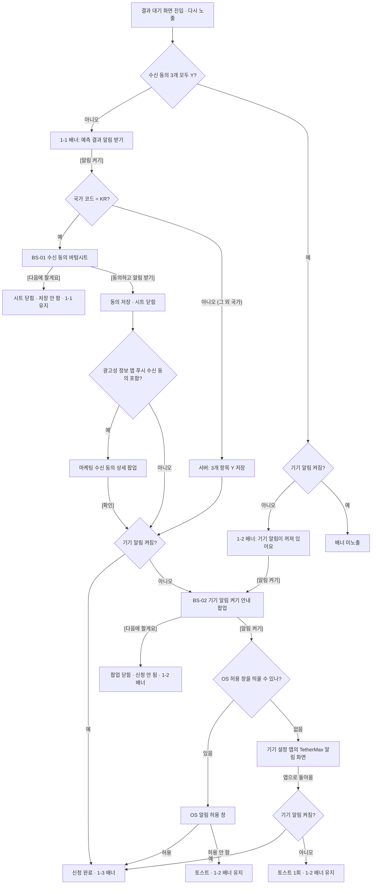

# 결과 알림 받기 플로우

기준 문서: PRD 프론트엔드 요구사항 7장(REQ-701 ~ 705), 백엔드 요구사항 7장(BE-701 · 702), Figma 02-1 알림 받기 바텀시트 · 팝업, 02-2 알림 받기 플로우. 내용이 다르면 PRD가 정본입니다.

## 1. 개요

- 위치: 결과 대기 화면(DV-P02)의 알림 배너. 다른 화면에는 알림 배너가 없습니다.
- 채널: 앱 푸시. 회차 판정이 끝나면 발송합니다.
- 신청 완료 조건: 수신 동의 3개 항목이 모두 Y이고 기기 알림이 켜져 있으면 신청 완료입니다. 서버에 별도 '신청' 값을 두지 않습니다.
- 기기 알림 허용 여부는 서버가 관리하지 않습니다. 앱이 OS에 조회합니다.
- 국가는 앱 접속 시 자동 생성되는 국가 코드로 판별합니다 (KR / 그 외).

## 2. 수신 동의 항목과 저장 값

| 동의 항목 (바텀시트 표기) | 저장 위치 (기존 알림 설정) |
| --- | --- |
| [필수] 서비스 알림 수신 동의 | 필수 알림 |
| [필수] 마케팅 정보 수신 동의 | 마케팅 정보 수신 동의 |
| [필수] 광고성 정보 앱 푸시 수신 동의 | 마케팅 알림 |

- 여기서 저장한 값은 기존 알림 설정 화면에도 그대로 반영됩니다.
- 항목별 동의 값과 동의 일시를 저장합니다.

## 3. 알림 배너 상태 (REQ-701)

| 상태 | 조건 | 배너 문구 | 버튼 |
| --- | --- | --- | --- |
| 1-1 | 필수 알림 · 마케팅 정보 수신 동의 · 마케팅 알림 중 하나라도 N | "예측 결과 알림 받기" / "투표 결과가 나오면 알림으로 알려드려요" | [알림 켜기] |
| 1-2 | 3개 모두 Y + 기기 알림 꺼짐 | "기기 알림이 꺼져 있어요" / "투표 결과가 나오면 알림으로 알려드려요" | [알림 켜기] |
| 1-3 | 알림 신청을 완료한 직후 | "알림 신청 완료" / "결과가 나오면 알림으로 알려드릴게요" | "신청 완료" (비활성) |
| 미노출 | 3개 모두 Y + 기기 알림 켜짐 (1-3 직후 제외) | — | — |

- 결과 대기 화면에 들어올 때 수신 동의 3개 값과 기기 알림 상태로 배너 상태를 정합니다.
- 1-2 배너는 조건에 해당하면 매 회차 노출합니다.
- 1-3 배너는 신청 완료 직후 같은 화면에 머무는 동안만 노출합니다. 다음 진입부터 배너를 노출하지 않습니다.
- 동의 · 권한 상태가 바뀌면 같은 화면에서 배너를 갱신합니다 (예: 1-1에서 동의 완료 후 기기 알림이 꺼져 있으면 1-2).

## 4. [알림 켜기] 처리 순서 (REQ-702)

| 시작 | 국가 · 상태 | 처리 |
| --- | --- | --- |
| 1-1 [알림 켜기] | 국가 코드 KR | 수신 동의 바텀시트(BS-01) 노출 |
| 1-1 [알림 켜기] | KR 외 국가 | 동의 화면 없이 서버에서 3개 항목 Y 저장 → 기기 알림 켜짐이면 1-3, 꺼짐이면 BS-02 |
| 1-2 [알림 켜기] | — | BS-02 노출 |
| BS-01 [동의하고 알림 받기] | 동의 항목에 광고성 정보 앱 푸시 수신 동의 포함 | 동의 저장 · 시트 닫힘 → 마케팅 수신 동의 상세 팝업 → [확인] → 기기 알림 확인 |
| BS-01 [동의하고 알림 받기] | 광고성 정보 앱 푸시 수신 동의 미포함 | 동의 저장 · 시트 닫힘 → 기기 알림 확인 |
| 기기 알림 확인 | 켜짐 | 신청 완료 → 1-3 |
| 기기 알림 확인 | 꺼짐 | BS-02 노출 |

KR 외 국가의 동의 처리 방식은 이용약관 · 개인정보처리방침 법무 검토 대상입니다.

## 5. 단계별 흐름

1. 회원이 결과 대기 화면에 들어옵니다. 앱은 수신 동의 3개 값과 기기 알림 상태로 배너 상태(1-1 / 1-2 / 미노출)를 정합니다.
2. 1-1 배너의 [알림 켜기]를 누릅니다.
   - 국가 코드가 KR이면 3단계로 갑니다.
   - KR 외 국가면 서버가 3개 항목을 Y로 저장하고 6단계(기기 알림 확인)로 갑니다.
3. 수신 동의 바텀시트(BS-01)가 열립니다. 미동의 항목만 보이고, 기본값은 모두 해제입니다.
   - [다음에 할게요]: 시트가 닫히고 아무것도 저장하지 않습니다. 1-1 배너가 그대로 남습니다.
   - [동의하고 알림 받기]: 노출된 항목을 모두 체크해야 활성입니다. 누르면 동의를 저장하고 시트를 닫습니다.
4. 이번에 광고성 정보 앱 푸시 수신 동의를 받았으면 마케팅 수신 동의 상세 팝업을 띄웁니다. 아니면 6단계로 갑니다.
5. 마케팅 수신 동의 상세 팝업의 [확인]을 누르면 6단계로 갑니다.
6. 앱이 기기 알림 상태를 확인합니다.
   - 켜져 있으면 신청 완료입니다. 배너가 1-3으로 바뀝니다.
   - 꺼져 있으면 기기 알림 켜기 안내 팝업(BS-02)을 띄웁니다.
7. 1-2 배너의 [알림 켜기]를 누르면 바로 BS-02를 띄웁니다.
8. BS-02에서
   - [다음에 할게요]: 팝업이 닫히고 신청되지 않습니다. 1-2 배너를 노출합니다.
   - [알림 켜기]: 팝업을 닫고 앱이 OS 알림 허용 창을 띄울 수 있는지 OS에 조회합니다.
9. OS 허용 창을 띄울 수 있으면 OS 허용 창을 띄웁니다. 문구와 형태는 OS가 제공하는 그대로입니다.
   - 허용: 신청 완료, 배너 1-3.
   - 허용 안 함: 토스트 "기기 알림이 꺼져 있어 결과 알림을 받을 수 없어요"를 띄우고 1-2 배너를 유지합니다.
10. OS 허용 창을 띄울 수 없으면 기기 설정 앱의 TetherMax 알림 화면으로 이동합니다. 회원이 직접 알림을 켭니다.
11. 회원이 앱으로 돌아와 결과 대기 화면이 다시 보이면 기기 알림 상태를 다시 확인합니다 (7장).

## 6. 화면별 구성

### 6.1 수신 동의 바텀시트 (BS-01, Figma DV-S08)

| 영역 | 구성 · 문구 | 조건 · 비고 |
| --- | --- | --- |
| 타이틀 | "투표 결과 알림을 받으려면 수신 동의가 필요해요" (2줄) | — |
| 서브텍스트 | "결과를 확인하기만 해도 적립금을 드려요" | — |
| 알림 미리보기 카드 | "TetherMax · 지금", "(광고) 투표 결과가 나왔어요", "적립금을 받고 연속 출석을 이어가세요" | 실제 발송 푸시와 같은 문구 |
| 전체 동의 | 체크박스 + "전체 동의" | 노출 항목이 2개 이상일 때만 노출 |
| 동의 항목 | 체크박스 + 항목명 + 우측 > | 미동의 항목만 노출. 기본값 모두 해제 |
| 보조 문구 | "결과 알림에 적립금·이벤트 안내가 포함돼 동의가 필요해요" | 광고성 정보 앱 푸시 수신 동의 항목 아래 |
| 버튼 | [동의하고 알림 받기], [다음에 할게요] | 세로 배치 |

- 전체 동의를 누르면 하위 항목을 일괄 체크 · 해제합니다. 하위 항목을 모두 체크하면 전체 동의도 체크됩니다.
- 항목 우측 >를 누르면 동의 상세 팝업을 띄웁니다. 문구는 법무 검토 후 확정합니다.

### 6.2 마케팅 수신 동의 상세 팝업 (Figma DV-S08 옆 팝업)

기존 알림 설정 화면의 마케팅 수신 동의 상세 팝업을 그대로 씁니다.

| 영역 | 구성 · 문구 |
| --- | --- |
| 타이틀 | "마케팅 수신 동의 상세" |
| 내용 | "• 전송자 : 테더맥스" / "• 수신일시 : {YYYY.MM.DD HH:MM:SS} UTC" / "• 처리 내용 : 마케팅 정보 수신 동의 알림 동의" / "• 마케팅 정보 수신 약관" |
| 버튼 | [확인] |

- 수신일시는 동의 저장 일시(UTC)입니다. 서버가 동의 저장 시 반환합니다.
- [확인]을 누르면 팝업을 닫고 기기 알림 확인 단계로 갑니다.

### 6.3 기기 알림 켜기 안내 팝업 (BS-02, Figma DV-S06)

| 영역 | 구성 · 문구 |
| --- | --- |
| 타이틀 | "기기 알림이 꺼져 있어요" |
| 서브텍스트 | "알림을 켜면 결과가 나왔을 때 바로 알려드려요" |
| 알림 미리보기 카드 | BS-01과 같음 |
| 버튼 | [알림 켜기], [다음에 할게요] |

[알림 켜기] 처리

| OS 허용 창 | 결과 | 처리 |
| --- | --- | --- |
| 띄울 수 있음 | 허용 | 신청 완료 → 1-3 |
| 띄울 수 있음 | 허용 안 함 | 토스트 "기기 알림이 꺼져 있어 결과 알림을 받을 수 없어요" → 1-2 |
| 띄울 수 없음 | — | 기기 설정 앱의 TetherMax 알림 화면 이동 |

- OS 허용 창을 띄울 수 있는지는 앱이 OS에 조회해 판단합니다. 예: Android에서 1회 거부한 고객은 다시 띄울 수 있고, iOS에서 거부한 고객은 띄울 수 없습니다.
- 토스트는 화면 하단에 2초 노출합니다.

## 7. 결과 대기 화면 복귀 처리 (REQ-705)

결과 대기 화면이 다시 노출될 때(백그라운드에서 복귀하거나 앱이 새로 실행된 경우 모두) 기기 알림 상태를 다시 확인해 배너를 갱신합니다.

| 기기 알림 | 배너 | 토스트 |
| --- | --- | --- |
| 켜짐 | 1-3 (알림 신청 완료) | 없음 |
| 꺼짐 | 1-2 (기기 알림이 꺼져 있어요) | [알림 켜기]로 기기 설정 앱에 이동한 뒤 처음 돌아왔을 때만 "기기 알림이 꺼져 있어 결과 알림을 받을 수 없어요" ([알림 켜기] 1회 선택당 1회) |

- 수신 동의는 이미 저장돼 있으므로 별도 신청 처리는 없습니다.
- 설정 앱으로 이동했다는 사실은 서버에 저장하지 않습니다.
- 웹뷰가 앱 복귀를 감지하는 방식은 개발 확인이 필요합니다.

## 8. 흐름도 (Mermaid)

## 9. 서버 처리 (BE-701 · 702)

| ID | 처리 |
| --- | --- |
| BE-701-1 | 회원의 수신 동의 3개 항목 값과 국가 코드 제공 |
| BE-701-2 | KR 회원: 바텀시트에서 동의한 항목의 값과 동의 일시를 항목별로 저장 |
| BE-701-3 | KR 외 회원: [알림 켜기] 선택 시 동의 화면 없이 3개 항목을 Y로 저장 (법무 검토 대상) |
| BE-701-4 | 광고성 정보 앱 푸시 수신 동의를 저장하면 동의 저장 일시(UTC) 반환 |
| BE-701-5 | 여기서 저장한 값은 기존 알림 설정 화면에도 그대로 반영 |
| BE-702-1 | 회차 판정이 끝나면 그 회차에 투표한 회원 중 수신 동의 3개 항목이 모두 Y인 회원에게 앱 푸시 발송 |
| BE-702-2 | 문구: "(광고) 투표 결과가 나왔어요" / "적립금을 받고 연속 출석을 이어가세요". 회원 언어로 발송 |
| BE-702-3 | 푸시를 누르면 미션으로 이동(딥링크). 진입 후 미확인 결과가 먼저 노출됨 |
| BE-702-4 | 회원 · 회차당 1회만 발송. 판정이 늦어지면 판정 후 발송 |
| BE-702-5 | 발송 직전에 수신 동의를 다시 확인. 그사이 철회한 회원에게는 발송하지 않음 |
| BE-702-6 (P1) | 판정 직후 대량 발송과 푸시 유입 집중에 대비해 나눠 보낼 수 있음 (방식은 개발 확인) |

## 10. 예외

| Code | 상황 | 처리 |
| --- | --- | --- |
| E08 | 기기 알림 허용 안 함 | 토스트 "기기 알림이 꺼져 있어 결과 알림을 받을 수 없어요" 노출, 1-2 배너 유지 |

## 11. 프로토타입 케이스

| 케이스 | 내용 |
| --- | --- |
| DV-N01 | 알림 받기 플로우 직접 조작 (기기 상태 패널로 국가 · 기기 알림 · OS 허용 창 가능 여부 변경) |
| DV-P02-b | 결과 대기 · 1-1 배너 |
| DV-P02-c | 결과 대기 · 1-2 배너 |
| DV-P02-d | 결과 대기 · 1-3 알림 신청 완료 직후 |
| DV-P02-s3 | 결과 대기 · 배너 미노출 |
| DV-S08 | 수신 동의 바텀시트 (BS-01) |
| DV-S08-m | 마케팅 수신 동의 상세 팝업 |
| DV-S06 | 기기 알림 켜기 안내 팝업 (BS-02) |
| DV-S05 | OS 알림 허용 창 (시뮬레이션) |
| DV-S07 | 기기 설정 앱 이동 (시뮬레이션) |

## 12. 확인 필요 사항 (법무)

- 수신 동의 처리결과 통지: 기존 '마케팅 수신 동의 상세' 팝업으로 충분한지
- 마케팅 정보 수신 동의만 새로 동의한 경우 처리결과 통지 의무가 있는지
- 광고성 정보 수신 동의를 결과 알림 수신 조건으로 거는 방식 (바텀시트 [필수] 표기 포함)
- 광고성 푸시 (광고) 표기 방식
- 동의 상세 팝업 문구: 약관 · 개인정보처리방침 개정안 확정 후 작성
